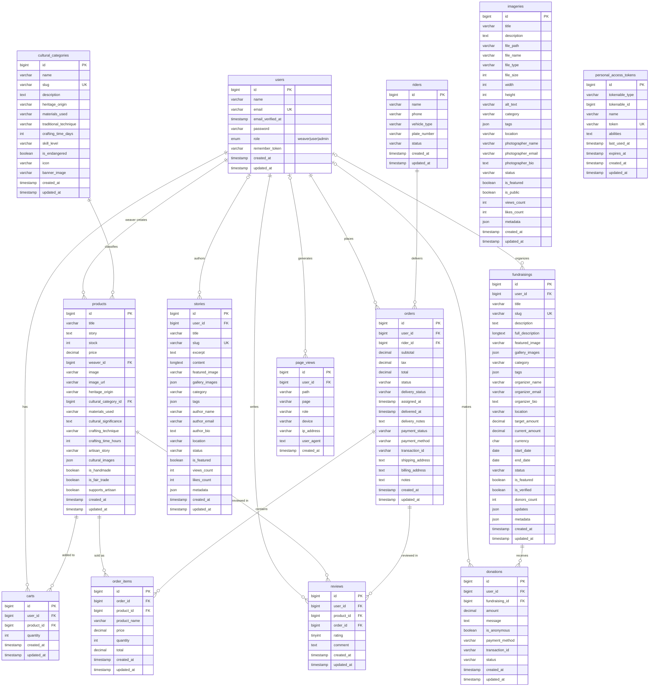

# Kultura — Database Entity Relationship Diagram (ERD)

> Auto-generated from the Laravel migrations in `backend/database/migrations`.
> **Roles:** `weaver` (seller), `user` (customer), `admin`.

---

## 1. ERD Diagram (Mermaid)

Copy the block below into any Mermaid renderer (GitHub, VS Code *Markdown Preview Mermaid Support*, [mermaid.live](https://mermaid.live)).



---

## 2. Relationships (plain summary)

| Parent | Child | FK column | On delete | Meaning |
|---|---|---|---|---|
| `users` | `products` | `weaver_id` | cascade | A weaver creates many products |
| `cultural_categories` | `products` | `cultural_category_id` | set null | A product may belong to one category |
| `users` | `carts` | `user_id` | cascade | A customer's cart lines |
| `products` | `carts` | `product_id` | cascade | Products inside a cart |
| `users` | `orders` | `user_id` | cascade | A customer places many orders |
| `riders` | `orders` | `rider_id` | set null | A rider may be assigned to deliver an order |
| `orders` | `order_items` | `order_id` | cascade | Line items of an order |
| `products` | `order_items` | `product_id` | cascade | Product snapshot sold in an order |
| `users` | `stories` | `user_id` | set null | Optional author of a story |
| `users` | `fundraisings` | `user_id` | set null | Optional owner of a campaign |
| `fundraisings` | `donations` | `fundraising_id` | cascade | A campaign receives many donations |
| `users` | `donations` | `user_id` | set null | Optional donor (nullable / anonymous) |
| `users` | `reviews` | `user_id` | cascade | A customer writes reviews |
| `products` | `reviews` | `product_id` | cascade | A product has many reviews |
| `orders` | `reviews` | `order_id` | cascade | Review is tied to a delivered order |
| `users` | `page_views` | `user_id` | set null | Optional viewer of a page |
| `users` (polymorphic) | `personal_access_tokens` | `tokenable_type/id` | — | Sanctum API tokens |

> **Standalone tables (no foreign keys):** `imageries`, `cultural_categories` (parent only), `riders` (parent only), `password_reset_tokens`, `failed_jobs`.

---

## 3. Key enums / status values

- **`users.role`** → `weaver`, `user`, `admin`
- **`orders.status`** → `pending`, `processing`, `shipped`, `delivered`, `cancelled`
- **`orders.delivery_status`** → `unassigned`, `assigned`, `picked_up`, `in_transit`, `delivered`, `failed`
- **`orders.payment_status`** → `unpaid`, `paid`, `refunded`, `failed`
- **`stories.status`** → `draft`, `published`, `archived`
- **`fundraisings.status`** → `active`, `completed`, `cancelled`, `suspended`
- **`donations.status`** → `completed`, `pending`, `refunded`, `failed`
- **`riders.status`** → `available`, `on_delivery`, `offline`
- **`riders.vehicle_type`** → `motorcycle`, `bicycle`, `van`

---

## 4. Core business flow

```
Weaver ──creates──▶ Product ──categorized by──▶ CulturalCategory
                        │
Customer ──adds──▶ Cart ──▶ Order ──contains──▶ OrderItem (snapshot of Product)
                            │   │
                            │   └──assigned──▶ Rider (delivery tracking)
                            │
                            └──(when delivered)──▶ Review (user + product + order)

Fundraising ──receives──▶ Donation ◀──made by── Customer
```


